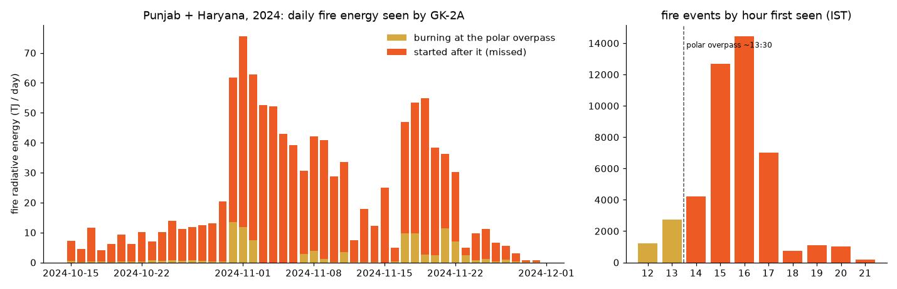

# Saanjh (ਸਾਂਝ, "dusk")

**Catching the farm fires India's official count misses, and warning people before their smoke arrives.**

India's daily farm-fire count comes from polar-orbiting satellites that pass over Punjab and Haryana around
1:30 pm. Farmers now burn at 4–5 pm. NASA's 2026 study of the Korean GK-2A geostationary satellite
([Jethva, Remote Sensing 18:1506](https://doi.org/10.3390/rs18101506)) showed the shift, and warned that
air-quality forecasts fed only by polar-orbiter fires underestimate the smoke. Saanjh is the operational
system that study calls for:

1. **See.** Detects fires in every GK-2A image of Punjab and Haryana (every 10 minutes), straight from NOAA's
   open-data bucket on AWS.
2. **Count energy, not dots.** Estimates each fire's radiative power over its lifetime and the PM2.5 it releases.
3. **Follow the smoke.** Moves it with forecast winds through the boundary layer, which shrinks to tens of metres after sunset.
4. **Act.** Ranks tonight's fires by how many people will breathe their smoke (for district officers) and
   tells each town when the smoke arrives (for schools), in English, Hindi and Punjabi.

## What we measured (2024 season, details in [results/NOTES.md](results/NOTES.md))




| | Result |
| --- | --- |
| Fire energy missed by the overpass, whole 2024 season | **90.9%** of 1,090 TJ detected (38,908 fire events, 15 Oct–30 Nov, every 10-minute image, replayed on AWS) |
| Fire energy missed by the overpass, 18 Nov 2024 | **87%** of the fire energy GK-2A detected came from fires not yet burning when VIIRS passed |
| Strong hotspots, same day | **2** at the 13:40 IST overpass vs **70–78** at 16:00–16:30 IST |
| The dusk penalty, 47 days | The same fire lit at 17:00 instead of 13:00 causes **2.9×** the population smoke exposure (200 m plume floor; 1.9× at 400 m), and is worse on all 47 days |
| Fire energy missed by the overpass, 2025 (held out) | **95.1%** of 1,510 TJ detected, with the detector frozen on 2024 |
| Does it explain measured pollution? (2025, 82 CPCB stations) | Adding the missed fires raises the daily correlation with PM2.5 near the fires from 0.21 to 0.29 in November (+0.08, 95% CI +0.01 to +0.16); no change in Delhi |
| GK-2A detection vs VIIRS at overpass, 2025 held out | 3% of fires under 5 MW, 24% at 20–40 MW, 43% at 40–80 MW; same curve as 2024 |
| Does a night-before smoke warning beat "tomorrow will be like today"? | **No.** Over 3,400 station-mornings, persistence (skill 0.37) beats the smoke forecast (0.23), and adding smoke to it does not help. We report it; see results/NOTES.md |

GK-2A sees Punjab from 66° off vertical, so its pixels are ~4 km and small fires are invisible to it.
We report that limit rather than hide it.

## How it runs on AWS

```
NOAA GK-2A bucket (us-east-1) ──SNS NewGK2AObject──▶ SQS ──▶ Lambda: detect (reads one 4 MB HDF5 chunk per band)
                                                               │
                                                               ▼
EventBridge Scheduler (hourly, 12:35–00:35 IST) ──▶ Lambda: fire events → smoke model → tonight.json ──▶ S3 ──▶ Lambda Function URL page
                                                               └──▶ SNS smoke alerts
Step Functions Map (8 days in parallel) ──▶ the same Lambdas over NOAA's archive  →  season replays
```

Everything is in [template.yaml](template.yaml) (AWS SAM). The Lambdas run next to NOAA's bucket, which
matters: from a laptop in India each crop takes ~17 s to download; in us-east-1 it takes about a second.

## Repository

| Path | What it is |
| --- | --- |
| `saanjh/gk2a.py` | Reads the Punjab crop of a GK-2A scan by HTTP range request; CGMS geolocation; calibration |
| `saanjh/detect.py` | Fire detector (contextual 3.8–11.2 µm anomaly, morning-normalised noise, cloud-edge and plains masks) and FRP |
| `saanjh/smoke.py` | Lagrangian smoke model on ERA5 / forecast winds with residual-layer mixing; WorldPop exposure |
| `saanjh/pipeline.py` | One evening end to end: fire events, counted vs missed, ranking, town arrival times, page JSON |
| `saanjh/aws.py` | Lambda handlers (live SQS, day replay, hourly model, alerts, the page) |
| `site/` | The public page and officer console (static, reads `tonight.json`) |
| `scripts/` | Data fetchers, scoring against VIIRS, dusk-penalty experiment, packaging |
| `PLAN.md` | Plan of record and the research behind the track choice |

## Run it

```bash
python3 -m venv .venv && .venv/bin/pip install -r requirements.txt
.venv/bin/python -m pytest -q                                   # geolocation, detector, handlers (mocked AWS)
PYTHONPATH=. .venv/bin/python scripts/export_day.py 2024-11-18 site/tonight.json
python3 -m http.server -d site 8765                               # open http://localhost:8765
```

Deploy: `./scripts/build_lambda.sh && sam deploy --stack-name saanjh --capabilities CAPABILITY_IAM --resolve-s3`.

## Limits and ethics

Village/2–4 km grid only; Saanjh never identifies farmers or plots. It is a targeting and early-warning tool,
not an enforcement one. Smoke values are the farm-fire share of PM2.5 from a simple model, not total pollution.

## Data and credits

GK-2A AMI L1B (KMA via NOAA Open Data Dissemination on AWS) · VIIRS active fires (NASA FIRMS) · ERA5 and
forecasts (Open-Meteo) · WorldPop 2020 · geoBoundaries · OpenAQ archive on AWS. Built during
Environmental Hacks (AWS × WeMakeDevs, Oct 2026) with Claude Code as the AI coding assistant.
